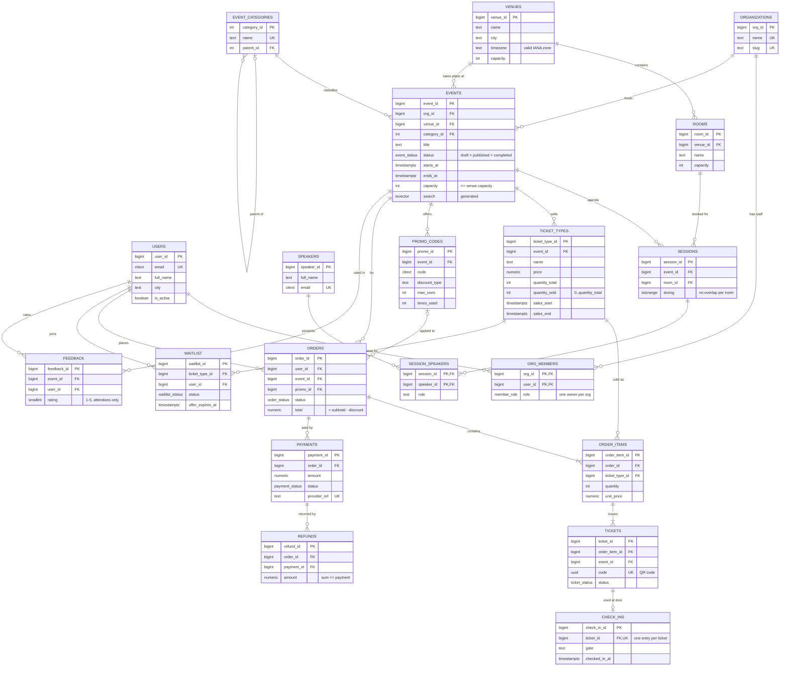

# Entity-relationship diagram

22 tables in three schemas: `app` (operational data), `report` (views) and `audit` (history).
Every column, type and constraint is listed in the [data dictionary](data_dictionary.md).

Not drawn: `app.scan_attempts` (log of every door scan, joined to tickets by `code`) and
`audit.change_log` (before/after values of changes to events, ticket types, orders, refunds and promo codes).

## Normalization

The schema is in third normal form, with two deliberate, constraint-protected exceptions:

| Denormalized column | Why | What keeps it correct |
|---|---|---|
| `tickets.event_id` (derivable through order_items → orders) | The door scanner checks "is this ticket for this event?" on every scan, and row-level security filters tickets by event | Trigger `tickets_event_check` rejects a value that differs from the order's event |
| `ticket_types.quantity_sold` (derivable by counting tickets) | Checking availability by counting tickets would scan thousands of rows inside the checkout's critical section | Changed only by `purchase_tickets` and `refund_order` under a row lock; `CHECK (quantity_sold BETWEEN 0 AND quantity_total)`; tests compare it with the real ticket count |
